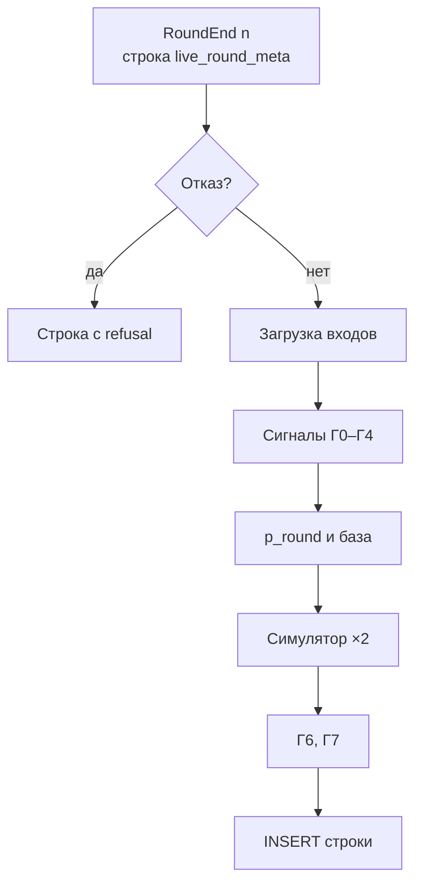

# SPEC_LIVE_P_ROUND — спецификация сигналов и p_round (лайв + пред-матчевый пакет)

2026-09-23 · выгрузка из Claude Docs (rev 25)

**Финальная версия для кода.** По этому документу исполнитель пишет движок без вопросов к математику. Против прошлой версии: база формы (Г9) берётся со страницы игрока, а не из `player_records`; одно окно на игрока; усадка к карте убрана; добавлены теневые метрики формы; пакет (§7) и аудит (§8) переписаны по разведке 2026-09-23.

## 0. Обозначения и соглашения

Все вероятности считаются для команды A — стартовавшей за CT, как `p_win_1` журнала. Входы: таблицы LIVE_FACTS и пред-матчевый пакет выбранного матча (§7). Корпус исторических карт для подгонки не собирается. Все коэффициенты — стартовые априоры, не подгонка.

**День матча.** D = дата UTC из `matches.scheduled_unix`. Все окна пакета заканчиваются днём D−1 включительно (анти-утечка §D контракта). Факт с датой ≥ D в расчёт не входит.

**Команды.** A = `live_round_meta.starting_ct`, B = `live_round_meta.starting_t` (team_id, одинаковы во всех строках карты). `p_*` всегда про A; для B берётся `1 − p`.

**Раунд прогноза.** r = (максимальный `round_no` в `live_round_meta` этой карты) + 1. Карта = (`match_id`, `map_name`).

**Момент T0 — до закупа.** Считаем сразу после появления строки `live_round_meta` с `round_no = r−1`. Используем только строки с `round_no ≤ r−1`. Из раунда r не берём ничего, включая `ct_equip_value`/`t_equip_value` его кадра.

**Длины половин.** H = `live_round_meta.reg_half` (NULL → 12), O = `ot_half` (NULL → 3). Первый раунд половины: r ∈ {1, H+1} или r = 2H+1+k·O при k ≥ 0.

**Сторона A в раунде r** — `side_A(r)` ∈ {CT, T}, `sgn_A(r)` = +1 для CT, −1 для T.

- r ≤ H → CT; H < r ≤ 2H → T.
- r > 2H → **НАБЛЮДЁННОЕ ПРАВИЛО (2026-09-28)**: на входе в овертайм стороны НЕ меняются, смена ровно после O раундов OT-половины, на границе овертаймов смены НЕТ. Формально: j = ⌊(r − 2H − 1) / O⌋ — номер OT-половины с нуля; сторона A = её сторона во второй половине регламента (T), перевёрнутая ⌈j/2⌉ = ⌊(j+1)/2⌋ раз.
  Для MR12+OT3 это даёт: r 25-27 → T, r 28-30 → CT, r 31-33 → CT, r 34-36 → T.

[ЗАМЕЩЕНО 2026-10-03. Прежняя редакция запрещала выводить сторону в OT расписанием: «r — первый раунд OT-половины → только из подтверждения `live_map_series.current_ct_id`… Правило смены сторон в OT по регламенту не выводим: живьём OT не наблюдался». Запрет был верен, пока овертайма не видели. Теперь он наблюдён — матч 2398243 / de_cache, 2026-09-27/28, первый живой OT проекта: 12 раундов с кадрами табло, `ct_team_id` фактов совпал с `currentCtId` ленты на всех, сверка сторон пульта не дала ни одного расхождения. Прежнее ДОПУЩЕНИЕ симулятора («перед овертаймом стороны меняются ещё раз») опровергнуто: сверка с фактами давала 6 расхождений из 12 раундов — весь первый овертайм был инвертирован. Разбор — `_reports/2026-10-03_5.5-этап5_проверка-и-разбор-прогона-2398243.md`, раздел 4 пункт (4).]

**Лента как КОНТРОЛЬ, а не источник.** `live_map_series.current_ct_id` сверяется с расписанием, когда строка ленты описывает ЭТОТ момент карты. Признак «описывает этот момент» — совпадение счёта: `(score_a, score_b)` строки ленты равны счёту A:B после раунда r−1. Проверки «`as_of` позже строки r−1» НЕДОСТАТОЧНО: строка ленты ОДНА на карту и хранит ПОСЛЕДНЕЕ состояние, поэтому для любого прошлого раунда она «свежее» автоматически. Замер на 2398243: при офлайн-досчёте такая проверка давала стороне r=25 ответ CT вместо T — один неверный ответ из трёх, без отказа. Расхождение свежей ленты с расписанием → прогноз не выдаём, `refusal = 'ot_side_unknown'`: расходится не мелочь, а понимание регламента.

**Функции.** σ(x) = 1/(1+e^(−x)), logit(p) = ln(p/(1−p)), clip(x, lo, hi).

**Флаги тестов (config).** `MONEY_INCLUDES_REWARD` — по тесту Т-деньги, до теста = `true` (рабочая гипотеза, в журнал пишется значение флага). Прогноз помечается `eco_mode`, чтобы строки до и после теста не смешивались.

**Не выдаём прогноз вообще:** `live_map_series.default_win = 1`; карта закончена; нет строки r−1 при r > 1. Всегда с кодом `refusal`, никогда тихо.

**Карта закончена — порог У ТЕКУЩЕЙ ФАЗЫ** [УТОЧНЕНО 2026-10-03, П3]. Пусть C = счёт, с которого обе команды вошли в текущую фазу: C = 0 в регламенте, H в первом овертайме, H+O во втором и так далее. Порог победы = `H+1` при C = 0, иначе `C + O + 1`. Для MR12+OT3: 13 в регламенте, 16 в первом OT, 19 во втором, 22 в третьем.

C определяется ПО ИСТОРИИ раундов: проход по `live_round_meta` от первого раунда, и каждая ничья на текущем пороге фазы (12:12, затем 15:15, затем 18:18) переводит C на следующий уровень.

⚠ **Формулой от счёта и числа раундов C не вывести.** Счёт 16:15 при 31 сыгранном раунде означает ЛИБО «первый овертайм выигран 4-3, карта закрыта», ЛИБО «первый овертайм кончился вничью 15:15, идёт первый раунд второго». У обоих вариантов совпадают И счёт, И число сыгранных раундов; различает их только факт ничьей 15:15. [ЗАМЕЩЕНО: прежняя редакция говорила просто «`map_over = 1` или счёт закрыт», а код проверял `max(a, b) >= 13`. В овертайме это объявляло карту закрытой на каждом раунде — замер прогона 2398243: 9 ложных отказов подряд (r25-33), при `mapOver = False` в ленте.]

## 1. Сигналы

В логит p_round входят: фон карты (Г0), экономика (Г1), сила пары `x_pair` (дуэли Г2 со стартом из пред-матчевой силы Г8), форма (Г9), а также теневые Г3 и Г4 с нулевыми коэффициентами — признак пишется, в p не влияет. Г5–Г7 — диагностика, в p_round не входят. Блоки Г8 и Г9 — в конце раздела.

### Г0. Фон карты — `x_map`

- **Формула:** `x_map = sgn_A(r) · logit(m_ct)`, где `m_ct` = CT-винрейт из `map_sidebias` по имени карты после `facts.map_name_from_stream(map_name)`.
- **Коэффициент:** множителя нет (1.0).
- **Нет строки / NULL:** `m_ct = 0.5` → `x_map = 0`, `map_bias_src = 'default'`.
- **Момент:** до матча, константа карты.

### Г1. Экономика — `x_eco`

Вход — 10 строк `live_player_round` с `round_no = r−1` (кадр конца r−1).

1. Для каждого игрока i: `m_i = money`; если `MONEY_INCLUDES_REWARD = false`, то `m_i += R_i` по таблице наград ниже.
2. Покупательная сила игрока: `b_i = min(m_i + alive_i · equip_value_i, CAP[side команды i в раунде r])`.
3. `E_A = Σ b_i` по игрокам с `team_id = A`, `E_B` — так же.

```latex
x_{eco} = G_{ECO}\,\big[\sigma\big(\tfrac{E_A - E_{MID}}{E_{SCALE}}\big) - \sigma\big(\tfrac{E_B - E_{MID}}{E_{SCALE}}\big)\big]
```

| константа | значение | смысл |
| --- | --- | --- |
| `G_ECO` | 2.5 | фулл против эко ≈ +2.2 логита (p ≈ 0.90) |
| `E_MID` | 10000 $ | середина перехода «форс → фулл» |
| `E_SCALE` | 3500 $ | ширина перехода |
| `CAP_CT` | 5500 $ | полный закуп игрока CT (винтовка, броня, кит, гранаты) |
| `CAP_T` | 5000 $ | полный закуп игрока T |

Слагаемое антисимметрично по командам, поэтому центрирования не требует: при одинаковых распределениях E среднее равно 0.

**Особые случаи:**

- r — первый раунд любой половины (регламент или OT): `x_eco = 0`, `eco_src = 'reset'`. Деньги равны по правилам.
- Кадра конца r−1 нет (`from_snapshot = 0` в строке r−1) или у команды не ровно 5 строк: `x_eco = 0`, `eco_src = 'none'`.
- `money` = NULL у любого игрока: `x_eco = 0`, `eco_src = 'none'`.
- `alive` = NULL → считать 0; `equip_value` = NULL при `alive = 1` → считать 0.
- Иначе `eco_src = 'frame'`.

**Таблица наград R_i** — используется только при `MONEY_INCLUDES_REWARD = false`; все значения сверить с правилами CS2 до включения:

| исход раунда r−1 для команды игрока | R_i |
| --- | --- |
| победа `CTs_Win` / `Terrorists_Win` / `Target_Saved` | 3250 |
| победа `Target_Bombed` (T) или `Bomb_Defused` (CT) | 3500 |
| поражение | 1400 + 500 · min(L − 1, 4), L = счётчик поражений подряд с учётом r−1 |
| поражение T при `bomb_planted = 1` | + 800 к строке выше |
| T жив при `Target_Saved` | 0 |

Правило счётчика L после победы (сброс или −1) — config `LOSS_RESET_MODE`, значение ставится после проверки правил CS2.

**Момент:** T0 (до закупа).

### Г2. Дуэльная сила — `theta_duel`, `x_duel`

Вход — `live_kills` карты с `round_no ≤ r−1`, упорядоченные по `event_id`. Для прошлых раундов j берётся ещё `live_round_meta` (стороны и закуп j).

1. В каждом раунде j старт `a = 5` (живые A), `b = 5` (живые B). Команду стороны определяют `ct_team_id`/`t_team_id` строки j (NULL → по расписанию §0).
2. Для каждого кила по порядку `event_id`:
    - `killer_side = victim_side` (своего) → уменьшить живых у команды жертвы, наблюдение не создавать;
    - `a = 0` или `b = 0` до кила → пропустить, `duel_anomalies += 1`;
    - иначе наблюдение k: `y_k = 1`, если убийца из A, иначе 0; состояние `(a, b)` ДО кила; затем уменьшить живых у команды жертвы.
3. `Eq_j = ln(equip_A,j / equip_B,j)` из `ct_equip_value`/`t_equip_value` строки j. NULL или 0 → `Eq_j = 0`. Для прошлых раундов это законно: j < r.

```latex
q_k^0 = \sigma\big(\theta_0 + K_{AP}\ln\tfrac{a}{b} + \Omega\,Eq_j\big),\quad
\hat\theta = \theta_0 + \frac{\sum_k (y_k - q_k^0)}{1/\tau^2 + \sum_k q_k^0(1-q_k^0)}
```

`theta0` — старт из Г8 (`c_prior / (ATT · C_W)`); без пакета `theta0 = 0`, и формула совпадает с прежней.

Это один шаг Ньютона от нуля с априором N(0, τ²); итераций не нужно.

Перевод в раунд — цепь «следующий кил» на сетке 6×6 при θ̂:

```latex
W(a,0)=1,\; W(0,b)=0,\; W(a,b)=q\,W(a,b-1)+(1-q)\,W(a-1,b),\; q=\sigma\big(\hat\theta + K_{AP}\ln\tfrac{a}{b}\big)
```

```latex
x_{duel} = ATT \cdot \mathrm{logit}\,W(5,5)
```

| константа | значение | смысл |
| --- | --- | --- |
| `KAP` | 1.2 | численное преимущество: в 5v4 следующий кил 0.567 |
| `OMEGA` | 0.5 | влияние закупа на дуэль |
| `TAU` | 0.35 | априорный разброс дуэльной силы (логит) |
| `ATT` | 0.5 | доля «чистой перестрелки» в исходе раунда (бомба и время разбавляют) |

**Контрольные значения для юнит-теста:** `W(5,5) = 0.5` при θ̂ = 0; при θ̂ = 0.1184 `logit W(5,5) = 0.2590`, то есть `x_duel = 0.1295`.

**Особые случаи:** r = 1 → нет килов → θ̂ = theta0 (без пакета 0), `x_duel = c_prior (без пакета 0)`. Перерыв и OT: θ̂ копится через всю карту, от стороны не зависит. Раунд j без единого кила — пропустить.

**Сверка, не сигнал:** в конце раунда j живые из реконструкции сравнить с `surviving_ct`/`surviving_t`, где они не NULL. Расхождение (суицид, смерть от взрыва) → `duel_alive_mismatch += 1`.

**Момент:** T0.

### Г3. Чистота раунда — `f_surv` (теневой)

- `s = +1`, если A выиграла r−1, иначе −1. Победитель: `winner_side` строки r−1 → команда через `ct_team_id`/`t_team_id`.
- `surv_w` = `surviving_ct` или `surviving_t` победителя из строки r−1. NULL → число `alive = 1` у команды победителя в `live_player_round` r−1. Снова NULL → `f_surv = NULL`, слагаемое 0.
- **Формула:** `f_surv = s · (surv_w − 2.5)`; `x_surv = ETA · f_surv`, **`ETA = 0.0`**.
- **Особые случаи:** r = 1 или первый раунд половины → `f_surv = 0` (экономика сброшена).
- **Момент:** T0.

### Г4. Момент — `f_prev`, `f_streak` (теневой)

- `f_prev = +1`, если A выиграла r−1, иначе −1.
- `f_streak` = знаковая длина текущей серии A, обрезанная до ±4 (только журнал).
- **Формула:** `x_mom = DELTA · f_prev`, **`DELTA = 0.0`**.
- **Особые случаи:** r = 1 → 0. Через перерыв и OT серия НЕ обнуляется — это и проверяется.
- **Момент:** T0.

### Г5. Дисперсия тотала — диагностика карты

Считается один раз при `settle()` карты по базовым `p_ct_base`/`p_t_base` из прогноза раунда 1:

- `z_total = (t_obs − E[T]) / sd[T]`, где T — тотал раундов из распределения симулятора;
- `pit_total = F(t_obs − 1) + 0.5 · P(T = t_obs)`.

Если прогноза раунда 1 нет — берётся первый прогноз карты, `g5_from_round` = его номер.

### Г6. Мартингал — диагностика раунда

`d_mart(r) = p_map(r) − p_map(r−1)`: разность прогнозов победы на карте на T0 соседних раундов. NULL, если прогноза r−1 нет.

### Г7. Конверсия после закладки — описательная

Для закрытого раунда j с `bomb_planted = 1`:

```latex
p^{pp}_T = \sigma\big(PP_0 + PP_1\,(bomb\_t\_alive - bomb\_ct\_alive)\big),\quad PP_0 = 0.9,\; PP_1 = 0.55
```

Исход `y_pp = 1`, если `winner_side = 'TERRORIST'`. NULL живых → NULL. Пишется в строку, созданную на T0 раунда j+1. В p_round не входит никогда: это описание уже сыгранного раунда.

### Г8. Сила пятёрки до матча — `c_prior`, `h_side` (априор для Г2)

Г8 не добавляется в логит отдельно: он задаёт стартовую точку дуэльной силы Г2, а лайв её сдвигает. Так пред-матчевая сила и живые дуэли не считаются дважды.

**Вход:** строка `lineup_map_stats` для (map_id этой карты, `lineup_hash` пятёрки команды, `date_from = D−30`, `date_to = D−1`) — по одной на A и на B. Фон — `map_sidebias`.

1. Нормировка: если `wr_ct`, `wr_t`, `ct_pct` или `t_pct` > 1 — делить на 100. `m_ct = ct_pct / (ct_pct + t_pct)`, `m_t = 1 − m_ct`.
2. Для команды T и стороны σ: `n = total_rounds / 2`, `w_T = n / (n + LAMBDA_STR)`, **`LAMBDA_STR = 100`**.
3. Усадка к фону и сила стороны:

```latex
\widehat{wr}_{T,\sigma} = w_T\,wr_{T,\sigma} + (1-w_T)\,m_\sigma,\qquad s_{T,\sigma} = \mathrm{logit}\,\widehat{wr}_{T,\sigma} - \mathrm{logit}\,m_\sigma
```

4. Пара: `x_ct = s_A,ct − s_B,t` (A за CT), `x_t = s_A,t − s_B,ct` (A за T). Общая часть и сторонняя:

```latex
c_{prior} = \tfrac{1}{2}(x_{ct} + x_t),\qquad h_{side} = \tfrac{1}{2}(x_{ct} - x_t)
```

**Стык с Г2.** Общая часть переводится в дуэльную шкалу линейно: `theta0 = c_prior / (ATT · C_W)`, **`C_W = 2.19`**. Проверено: при |c| ≤ 0.5 ошибка обратного перевода < 1 %. Дальше Г2 стартует не с нуля, а с `theta0`:

```latex
q_k^0 = \sigma\big(\theta_0 + K_{AP}\ln\tfrac{a}{b} + \Omega\,Eq_j\big),\qquad
\hat\theta = \theta_0 + \frac{\sum_k (y_k - q_k^0)}{1/\tau^2 + \sum_k q_k^0(1-q_k^0)}
```

```latex
c_{post} = ATT\cdot\mathrm{logit}\,W(5,5;\hat\theta),\qquad x_{pair}(r) = c_{post} + sgn_A(r)\cdot h_{side}
```

`x_pair` **заменяет** `x_duel` в логите (§2). `h_side` по ходу карты не обновляется: сторонних дуэлей слишком мало. На r = 1 `θ̂ = θ0`, и `p_round = σ(x_map + x_ct)` — ровно замороженная формула _STATE.

**Замена в составе.** Наблюдаемая пятёрка команды = различные `player_id` её строк `live_player_round` плюс `killer_id`/`victim_id` её стороны в `live_kills`. `k_T` = пересечение с пятёркой пакета. Множитель к `w_T`: k = 5 → 1; k = 4 → 0.5; k ≤ 3 → 0 (то есть `s_T = 0`). До первых данных карты пятёрка пакета берётся как есть, `lineup_src = 'unverified'`.

**Особые случаи:** строки нет → `s_T,σ = 0`, `str_src = 'no_row'`; `total_rounds` NULL или 0 → `w_T = 0`; map_id карты неизвестен (Vertigo) → `c_prior = h_side = 0`, `str_src = 'no_map_id'`. OT: те же `h_side` по стороне.

**Окно и сбор.** Окно силы пятёрки — 30 дней (решение _STATE). В коде `assemble.window_for` сейчас 90 дней — привести к 30; до этого `LAMBDA_STR` не калибруется (§6). Окно силы НЕ квантуется до недели: 6 дней из 30 — это 20 % окна. Если пакет собирается во время матча, строка тянется только по текущей карте (2 запроса); остальные карты серии дотягиваются при их старте, и первый раунд такой карты идёт с `pkg_src = 'late'`. Команда пакета связывается с командой лайва через `roster.team_id` (§8.5).

**Момент:** `c_prior`, `h_side` — до матча; `θ̂`, `c_post` — T0 каждого раунда.

### Г9. Форма игрока — `x_form`

Форма = отклонение живых ADR и KAST игрока от его базы за окно до матча, с усадкой по числу раундов. «Свежая форма» — только лайв текущей карты: одно окно на игрока, 10 запросов на матч. Второе окно на 30 дней и тренд по списку матчей отклонены: вклад ≤ 0.03 логита, пересечение с Г8 (решение 2026-09-23).

**База (до матча)** — таблица `player_form_base` (§7, блок 6). Источник — страница игрока `/stats/players/{id}?startDate&endDate`: одно усреднённое значение за окно по срезам `all` / `ct` / `t`, только НЕ eco-adjusted.

1. **Окно:** `date_to` = последнее воскресенье ≤ D−1, `date_from = date_to − 89` (90 дней). Если `rounds_played < 500`, делается второй запрос с `date_from = date_to − 179` (180 дней) и берётся он. Длина окна пишется в `window_days`.
2. **ADR по стороне σ:** `B_ADR,σ` = `Damage per round` среза σ, `n_σ = rounds_played / 2`. Сторонний срез пуст → combined для обеих сторон.
3. **KAST:** `B_KAST = KAST(all) / 100`, `n = rounds_played`. По сторонам KAST на странице нет.
4. **Усадка к популяции:**

```latex
B1_k = \frac{n_k\,B_k + \Lambda^{pop}_k\,POP_k}{n_k + \Lambda^{pop}_k}
```

| метрика | n_k | POP_k | разброс между игроками | Λ^pop_k = S² / разброс² |
| --- | --- | --- | --- | --- |
| ADR по стороне | `rounds_played / 2` | 75 | 8 | **150** |
| KAST | `rounds_played` | 0.72 | 0.03 | **225** |

Игрок с 1438 раундами получает вес собственных данных 0.83 (ADR по стороне) и 0.86 (KAST). `rounds_played = 0` → база = `POP_k`.

**Почему 90 дней.** Пусть уровень игрока блуждает со скоростью σ_m ADR в месяц, игрок играет R раундов в месяц. Ошибка среднего за окно L месяцев:

```latex
MSE(L) = \frac{S^2}{R\,L} + \frac{\sigma_m^2\,L}{3},\qquad L^* = \sqrt{\frac{3S^2}{R\,\sigma_m^2}},\qquad S = 98
```

| R, раундов/мес | σ_m = 2 | σ_m = 3 |
| --- | --- | --- |
| 480 | 116 дней | 77 дней |
| 200 | 180 дней | 120 дней |

Для активного игрока 90 дней — внутри оптимума; для редко играющего нужно около 180 дней, отсюда правило `rounds_played < 500`.

**Текущая (лайв)** — последний кадр `live_player_round` игрока с `round_no = n ≤ r−1`: `ADR_live = adr`, `KAST_live = kast_rounds / n`.

**Смесь сторон — только для ADR.** `n_ct`, `n_t` — сколько из раундов 1…n команда игрока была за CT и за T (по `ct_team_id`, NULL → расписание §0). `base_mix_ADR = (n_ct · B1_ADR,ct + n_t · B1_ADR,t) / n`. Для KAST база = `B1_KAST`.

**Отклонение и слагаемое:**

```latex
d_{ik} = \frac{n}{n + \Lambda_k}\cdot\frac{live_{ik} - base_{ik}}{T_k},\qquad F_i = \tfrac12 d_{i,ADR} + \tfrac12 d_{i,KAST}
```

```latex
F_T = \tfrac15\sum_{i\in T} F_i,\qquad x_{form} = GAMMA\_FORM\cdot(F_A - F_B),\quad GAMMA\_FORM = 0.25
```

| метрика | шум за раунд S | разброс истинной формы T_k | Λ_k = (S/T_k)² |
| --- | --- | --- | --- |
| ADR | 98 | 6 | 267 раундов |
| KAST | 0.45 | 0.04 | 126 раундов |

`d` — апостериорное среднее отклонения истинной формы в единицах её разброса. К 12-му раунду вес ADR 0.043, KAST 0.087: внутри карты форма — слабый сигнал. Поднимать `GAMMA_FORM` на глаз нельзя, только по тесту §6. Теневая колонка `form_disp_T` = стандартное отклонение `F_i` внутри команды.

**Теневые компоненты.** Отклонение `d_ik` считается по той же формуле, усреднение по пятёрке — как у `F_T`. Результат пишется в `form_shadow_json` (метрика → [F_A, F_B]), в `x_form` не входит. Усадка к популяции для теневых не применяется: окно гарантирует не меньше 500 раундов.

| метрика | база со страницы (по сторонам) | лайв | S | T_k | Λ_k |
| --- | --- | --- | --- | --- | --- |
| флеш-ассисты | `Flash assists per round` | `flash_assists / n` | 0.28 | 0.02 | 196 |
| ассисты | `Assists per round` | `assists / n` | 0.45 | 0.03 | 225 |
| размены | `Trade kills per round` | `trades / n` | 0.35 | 0.02 | 306 |
| открытия (дубль Г2) | `Opening kills per round`, `Opening deaths per round` | `entry_kills / n`, `entry_deaths / n` | 0.29 | 0.02 | 210 |
| мультикилы (дубль Г2) | `Rounds with a multi-kill` / 100 | `multikill_rounds / n` | 0.34 | 0.02 | 289 |

S и T_k теневых провизорны. Размены включаются в журнал только после сверки, что `trades` лайва и `Trade kills` страницы — одно событие (§8.2).

**Не берём:** 1vX (в лайве — число выигранных клатчей, на странице — доля выигранных дуэлей 1v1; величины разные); K/D, KPR, DPR (исходы дуэлей, уже в Г2); HS % (стиль стрельбы, а не отклонение формы); rating (в лайве нет, шкала на HLTV сменилась на 3.0); снайперские, utility-метрики и время жизни (пары в лайве нет).

**Особые случаи:**

- r = 1 или нет ни одного кадра → `x_form = 0`, `form_src = 'no_frame'`.
- Страница игрока не получена → `F_i = 0`; учитывается в `form_n_base`. Нет базы ни у одного игрока обеих команд → `form_src = 'no_base'`.
- Замена по ходу карты → +1 запрос по `dbId`; до ответа `F_i = 0`.
- OT: смесь сторон считает фактические стороны.
- Иначе `form_src = 'frame'`.

**Момент:** база — до матча; текущая и `x_form` — T0. `x_form` входит и в p_round, и в базу будущих раундов (§2).

## 2. Итоговая формула p_round и передача в симулятор

p_round раунда r — сумма слагаемых §1 в логите, с обрезкой [0.03, 0.97]. Будущие раунды симулятор считает по базовым p без экономики и теневых слагаемых.

**Раунд r (текущий):**

```latex
L_A(r) = x_{map} + x_{eco} + x_{pair} + x_{form} + ETA\cdot f_{surv} + DELTA\cdot f_{prev},\qquad ETA = 0,\; DELTA = 0
```

`x_pair = c_post + sgn_A(r) · h_side` (Г8 + Г2). Без пакета `h_side = 0` и `x_pair = x_duel`.

```latex
p^{round}_A = \mathrm{clip}\big(\sigma(L_A),\,0.03,\,0.97\big),\qquad p^{round}_B = 1 - p^{round}_A
```

Комплементарность точная: все слагаемые антисимметричны по A/B, обрезка симметрична. `f_surv = NULL` даёт в логит 0.

**Будущие раунды r+1, r+2, … (база):**

```latex
p^{base}_{ct} = \mathrm{clip}\big(\sigma(+\mathrm{logit}\,m_{ct} + c_{post} + h_{side} + x_{form}),\,0.20,\,0.80\big)
```

```latex
p^{base}_{t} = \mathrm{clip}\big(\sigma(-\mathrm{logit}\,m_{ct} + c_{post} - h_{side} + x_{form}),\,0.20,\,0.80\big)
```

Это вероятности A взять раунд за CT и за T. Экономики в базе нет: она относится только к раунду r. В базу входят сила пары и форма — это оценки на всю оставшуюся карту. Обрезка базы остаётся прежней, [0.20, 0.80].

**Передача в симулятор — два вызова, симулятор не меняется:**

1. Счёт на T0: `sa`, `sb` — очки A и B из строки r−1 (`score_ct`/`score_t`, разнесённые по командам через `ct_team_id`). `n = r − 1`.
2. `W_win` = P(A выигрывает карту) при счёте (sa+1, sb), сыграно r, входы `p_ct = p^base_ct`, `p_t = p^base_t`, `a_start_ct = True`.
3. `W_lose` = то же при счёте (sa, sb+1), сыграно r.
4. Результат:

```latex
p^{map}_A = p^{round}_A\,W_{win} + (1-p^{round}_A)\,W_{lose},\qquad imp = W_{win} - W_{lose}
```

Распределения тотала и форы смешиваются так же: `P(·) = p^round · P_win(·) + (1 − p^round) · P_lose(·)`. Ожидаемый тотал — та же смесь. Если исход раунда r заканчивает карту, соответствующая ветка отдаёт 1 или 0 без симуляции.

**Раунд 1:** `x_eco = x_form = 0`, `θ̂ = theta0` → `p_round = σ(x_map + x_ct)` = база стороны. Два вызова симулятора дают ровно p карты по замороженной формуле _STATE.

⚠ **OT:** правило сторон внутри OT у симулятора зашито; с реальным потоком оно не сверено (OT не наблюдался). Строки при r > 2H помечаются `ot = 1`.

## 3. Алгоритм на раунд

Одна строка журнала на каждый закрытый раунд n. Она описывает раунд n и несёт прогноз на раунд r = n+1 — так же, как сейчас работает `live_forecast_snapshots` (последний раунд карты пишется с пустыми прогнозными полями).



0. **До матча, один раз:** из пакета (§7) посчитать `c_prior`, `h_side` (Г8) и базы `B1` 10 игроков из `player_form_base` (Г9, с усадкой к популяции). Записать Г8 в шапку прогноза карты, базы — в `live_form_base`. Пакета нет → нули и `pkg_src = 'none'`; пакет или его часть пришли позже → со следующего раунда `pkg_src = 'late'`.
1. **Триггер.** Новая строка `live_round_meta` (`match_id`, `map_name`, `round_no = n`). r = n+1.
2. **Проверки отказа** (код в `refusal`, прогнозные поля NULL):
    - `default_win = 1` → `'default_win'`;
    - карта закончена после n (счёт команды достиг победного или `map_over = 1`) → `'map_over'`, строка всё равно пишется со счётом;
    - `round_no` карты не идут подряд 1…n → `'round_gap'`;
    - сторона A в r не определена (§0) → `'ot_side_unknown'`.
3. **Загрузка входов:** строки `live_round_meta` 1…n; последний кадр `live_player_round` с `round_no ≤ n` (для Г1 нужен именно `round_no = n`); `live_kills` с `round_no ≤ n`; `map_sidebias`; величины шага 0.
4. **Составы:** наблюдаемые пятёрки → `k_A`, `k_B` → множители `w` Г8 (пересчитать `c_prior`, `h_side`, если `k < 5`). Игрок без базы (замена) → запрос его формы по `dbId`, до ответа `F_i = 0`.
5. **Сигналы:** `x_map` (Г0) → `x_eco`, `eco_src` (Г1) → `theta0`, `theta_duel`, `c_post`, `x_pair` (Г8 + Г2) → `x_form`, `form_shadow_json` (Г9) → `f_surv` (Г3) → `f_prev`, `f_streak` (Г4).
6. **p_round:** `L_A` и `p_round_A` по §2; `p_round_B = 1 − p_round_A`.
7. **База:** `p_ct_base`, `p_t_base` по §2.
8. **Симулятор:** два вызова → `W_win`, `W_lose`; смеси → `p_map_A`, `imp`, `e_total`, вероятности по линиям тотала и форы.
9. **Диагностика:** `d_mart` к предыдущей строке; Г7 для раунда n при `bomb_planted = 1`.
10. **Запись:** INSERT одной строки, ключ `UNIQUE (forecast_id, round_no)` — повторный прогон даёт отказ вставки, а не дубль.
11. **Settle карты:** Г5 в шапку `live_forecasts`, однократно.

**Инварианты:** на шаге 3 ни одной строки с `round_no > n`; прогноз без числа лучше испорченного — любой отказ громкий; каждая строка несёт `model_version` и `config_hash`.

## 4. Колонки журнала

Дорожка `live_forecast_snapshots` получает колонки ниже; строка = закрытый раунд n + прогноз на r = n+1. Колонки, которые уже есть (`forecast_id`, `round_no`, `p_win_1`, `surviving_ct`/`surviving_t`, `model_version`, `config_hash`, счёт, победитель), не меняются. `p_win_1` = `p_map_a`.

| колонка | тип | смысл |
| --- | --- | --- |
| `target_round` | INTEGER | r = n+1, раунд прогноза |
| `ct_team_id` | INTEGER | кто был за CT в раунде n (закрывает Д-3) |
| `refusal` | TEXT | код отказа или NULL |
| `ot` | INTEGER | 1, если r > 2H |
| `side_a` | TEXT | сторона A в раунде r: `CT` / `T` |
| `score_a`, `score_b` | INTEGER | счёт A и B после раунда n |
| `m_ct`, `map_bias_src` | REAL, TEXT | фон карты и его источник (`table` / `default`) |
| `x_map` | REAL | Г0 |
| `e_a`, `e_b` | REAL | покупательная сила A и B, $ |
| `eco_src`, `eco_mode` | TEXT | `frame` / `reset` / `none`; значение флага `MONEY_INCLUDES_REWARD` |
| `x_eco` | REAL | Г1 |
| `duel_n` | INTEGER | число дуэльных наблюдений |
| `duel_u`, `duel_i` | REAL | Σ(y − q⁰) и Σ q⁰(1 − q⁰) |
| `theta_duel`, `x_duel` | REAL | Г2 |
| `duel_anomalies`, `duel_alive_mismatch` | INTEGER | пропущенные килы; расхождения живых с `surviving_*` |
| `f_surv` | REAL | Г3, теневой |
| `f_prev`, `f_streak` | INTEGER | Г4, теневые |
| `l_a`, `p_round_a` | REAL | логит и вероятность A взять раунд r |
| `p_ct_base`, `p_t_base` | REAL | база для будущих раундов |
| `w_win`, `w_lose`, `imp` | REAL | p карты после победы / поражения в r; их разность |
| `p_map_a` | REAL | p победы A на карте (= `p_win_1`) |
| `e_total` | REAL | ожидаемый тотал раундов |
| `lines_json` | TEXT | JSON: вероятности по линиям тотала и форы |
| `d_mart` | REAL | Г6 |
| `pp_planted` | INTEGER | Г7: была ли закладка в раунде n |
| `pp_t_alive`, `pp_ct_alive` | INTEGER | живые на момент закладки |
| `pp_p_t`, `pp_y` | REAL, INTEGER | прогноз и исход T после закладки |

**Добавлено под Г8 и Г9** (дорожка, на каждый раунд):

| колонка | тип | смысл |
| --- | --- | --- |
| `pkg_src` | TEXT | `full` / `partial` / `late` / `none` / `unmatched` — состояние пакета на момент строки |
| `lineup_k_a`, `lineup_k_b` | INTEGER | совпадение наблюдаемой пятёрки с пакетом, 0…5 |
| `lineup_src` | TEXT | `verified` / `unverified` |
| `str_src` | TEXT | `table` / `no_row` / `no_map_id` / `mismatch` |
| `c_prior`, `h_side`, `theta0` | REAL | Г8 после множителей состава |
| `c_post`, `x_pair` | REAL | Г8 + Г2 после апдейта; `x_duel` остаётся для сверки (без пакета они равны) |
| `f_team_a`, `f_team_b` | REAL | F команды (Г9) |
| `x_form` | REAL | Г9 |
| `form_src` | TEXT | `frame` / `no_frame` / `no_base` |
| `form_n_base_a`, `form_n_base_b` | INTEGER | игроков с базой, 0…5 |
| `form_disp_a`, `form_disp_b` | REAL | разброс F внутри команды, теневой |
| `form_shadow_json` | TEXT | JSON: теневая метрика → [F_A, F_B] |

**Шапка `live_forecasts`** дополнительно: `pkg_as_of` TEXT, `s_a_ct`, `s_a_t`, `s_b_ct`, `s_b_t`, `w_a`, `w_b` REAL (Г8 до составов). Базы игроков — отдельная таблица движка `live_form_base` (`forecast_id`, `player_id`, `side` ∈ {all, ct, t}, `metric`, `base_raw`, `base_b1`, `n_rounds`, `window_days`), чтобы строка дорожки не росла на 40 колонок. Для теневых `base_b1 = base_raw`.

**Шапка `live_forecasts`** (дозапись при `settle()`): `z_total` REAL, `pit_total` REAL, `g5_from_round` INTEGER.

Константы коэффициентов в строку не пишутся: их фиксирует `config_hash`.

## 5. Числовой пример: de_mirage, прогноз на раунд 8

Итог: `p_round_A = 0.4212`, `p_map_A = 0.6493`. Экономика отнимает у A 0.024 карты против прогноза без неё (0.6734). Значения полей выдуманы, но правдоподобны; все числа пересчитаны.

**Состояние.** Закрыт раунд n = 7, r = 8. A стартовала за CT → в раунде 8 A за CT, `sgn = +1`. Счёт A 4 : 3 B. Раунд 7 взяла B (T) по `Target_Bombed`, `surviving_t = 2`. Кадр конца раунда 7 есть. Флаг `MONEY_INCLUDES_REWARD = true`.

**Шаг 1. Фон.** `m_ct = 0.527` → `x_map = +1 · logit(0.527) = 0.1081`.

**Шаг 2. Экономика** (кадр `live_player_round`, `round_no = 7`; A — CT в r, CAP 5500; B — T, CAP 5000):

| игрок | money | alive | equip_value | b_i |
| --- | --- | --- | --- | --- |
| A1 | 2100 | 0 | — | 2100 |
| A2 | 1850 | 0 | — | 1850 |
| A3 | 3300 | 1 | 4700 | min(8000, 5500) = 5500 |
| A4 | 2600 | 0 | — | 2600 |
| A5 | 1950 | 0 | — | 1950 |
| B1 | 4400 | 1 | 3700 | min(8100, 5000) = 5000 |
| B2 | 5200 | 0 | — | min(5200, 5000) = 5000 |
| B3 | 3900 | 0 | — | 3900 |
| B4 | 6100 | 1 | 3100 | min(9200, 5000) = 5000 |
| B5 | 4800 | 0 | — | 4800 |

`E_A = 14000`, `E_B = 23700`. σ((14000 − 10000)/3500) = σ(1.1429) = 0.7582; σ((23700 − 10000)/3500) = σ(3.9143) = 0.9804. `x_eco = 2.5 × (0.7582 − 0.9804) = −0.5556`, `eco_src = 'frame'`.

**Шаг 3. Дуэли.** Первые три кила раунда 1: закуп A 4150, B 3900 → `Ω · Eq_1 = 0.5 · ln(4150/3900) = 0.0311`.

| кил | (a, b) до | убийца | q⁰ | y − q⁰ | q⁰(1 − q⁰) |
| --- | --- | --- | --- | --- | --- |
| 1 | (5, 5) | A | σ(0.0311) = 0.5078 | +0.4922 | 0.2499 |
| 2 | (5, 4) | B | σ(1.2 · ln 1.25 + 0.0311) = 0.5742 | −0.5742 | 0.2445 |
| 3 | (4, 4) | A | 0.5078 | +0.4922 | 0.2499 |

По всем раундам 1–7: `duel_n = 52`, `duel_u = 2.4`, `duel_i = 12.1`. θ̂ = 2.4 / (1/0.35² + 12.1) = 2.4 / 20.263 = 0.1184. Цепь даёт `W(5,5) = 0.5644`, logit = 0.2590 → `x_duel = 0.5 × 0.2590 = 0.1295`.

**Шаг 4. Теневые.** A проиграла раунд 7 → `s = −1`, `f_surv = −1 × (2 − 2.5) = +0.5`; `f_prev = −1`; B взяла раунды 6 и 7 → `f_streak = −2`. ETA = DELTA = 0 → вклад 0.

**Шаг 5. p_round.** `L_A = 0.1081 − 0.5556 + 0.1295 = −0.3180` → `p_round_A = σ(−0.3180) = 0.4212` (обрезка не срабатывает), `p_round_B = 0.5788`.

**Шаг 6. База.** `p_ct_base = σ(0.1081 + 0.1295) = 0.5591`; `p_t_base = σ(−0.1081 + 0.1295) = 0.5054`.

**Шаг 7. Симулятор.** `W_win` при 5 : 3, сыграно 8 → 0.7502. `W_lose` при 4 : 4, сыграно 8 → 0.5759.

```latex
p^{map}_A = 0.4212 \times 0.7502 + 0.5788 \times 0.5759 = 0.6493,\qquad imp = 0.1743
```

Для сравнения: без экономики (p_round = 0.5591) было бы 0.6734. Раунд 8 стоит 17 пунктов карты, и сейчас он чуть в пользу B. Симулятор Монте-Карло с n = 50 000 даёт те же числа ±0.002.

**Шаг 8. Диагностика.** Если прогноз карты в строке раунда 6 был 0.6710, `d_mart = 0.6493 − 0.6710 = −0.0217`. Г7 для раунда 7: закладка при 3 T и 3 CT → `pp_p_t = σ(0.9) = 0.7109`, `pp_y = 1`.

### 5.2. Тот же раунд 8 с пред-матчевым пакетом

С пакетом `p_round_A = 0.4326` вместо 0.4212 и `p_map_A = 0.6756` вместо 0.6493. Прибавка почти целиком от силы пятёрки (Г8); форма (Г9) на 7-м раунде даёт +0.0008 логита — так и должно быть при таком шуме. Экономика, фон и теневые — как в примере выше.

**Г8, до матча.** `m_ct = 0.527`, `m_t = 0.473`, `LAMBDA_STR = 100`.

| пятёрка | wr_ct | wr_t | total_rounds | w | ŵr_ct | ŵr_t | s_ct | s_t |
| --- | --- | --- | --- | --- | --- | --- | --- | --- |
| A | 0.56 | 0.50 | 220 | 110/210 = 0.5238 | 0.5443 | 0.4871 | +0.0695 | +0.0567 |
| B | 0.51 | 0.45 | 160 | 80/180 = 0.4444 | 0.5194 | 0.4628 | −0.0303 | −0.0411 |

`x_ct = 0.0695 + 0.0411 = 0.1106`, `x_t = 0.0567 + 0.0303 = 0.0870` → `c_prior = 0.0988`, `h_side = 0.0118`. `theta0 = 0.0988 / (0.5 × 2.19) = 0.0902`. Пред-матч (r = 1): `p_round = σ(0.1081 + 0.1106) = 0.5545`, p карты 0.6049.

**Составы:** обе пятёрки совпали, `k_A = k_B = 5`, множители 1.

**Г2 от theta0.** Те же 52 дуэли, но q⁰ считаются от 0.0902: `duel_u = 1.2` (часть побед A пакет уже ожидал), `duel_i = 12.05`. θ̂ = 0.0902 + 1.2 / (8.163 + 12.05) = 0.1496. `c_post = 0.5 × logit W(5,5; 0.1496) = 0.1637`. A за CT → `x_pair = 0.1637 + 0.0118 = 0.1755`.

**Г9.** n = 7, все 7 раундов A за CT, B за T → для ADR `base_mix` = база стороны. В таблице ниже базы — уже после усадки к популяции (`B1`): ADR — по стороне, KAST — combined (по сторонам его на странице нет). Веса: ADR 7/274 = 0.0255, KAST 7/133 = 0.0526.

| игрок | база ADR | ADR live | база KAST | KAST live | d_ADR | d_KAST | F_i |
| --- | --- | --- | --- | --- | --- | --- | --- |
| A1 | 82 | 95 | 0.74 | 6/7 | +0.055 | +0.154 | +0.105 |
| A2 | 74 | 60 | 0.70 | 4/7 | −0.060 | −0.169 | −0.114 |
| A3 | 88 | 101 | 0.73 | 6/7 | +0.055 | +0.167 | +0.111 |
| A4 | 70 | 66 | 0.71 | 5/7 | −0.017 | +0.006 | −0.006 |
| A5 | 77 | 80 | 0.72 | 5/7 | +0.013 | −0.008 | +0.003 |
| B1 | 79 | 88 | 0.71 | 5/7 | +0.038 | +0.006 | +0.022 |
| B2 | 85 | 97 | 0.73 | 6/7 | +0.051 | +0.167 | +0.109 |
| B3 | 72 | 70 | 0.69 | 5/7 | −0.009 | +0.032 | +0.012 |
| B4 | 76 | 83 | 0.70 | 5/7 | +0.030 | +0.019 | +0.024 |
| B5 | 70 | 64 | 0.68 | 4/7 | −0.026 | −0.143 | −0.084 |

Пример строки A1: `d_ADR = 0.0255 × (95 − 82) / 6 = 0.0554`, `d_KAST = 0.0526 × (0.857 − 0.74) / 0.04 = 0.1541`. `F_A = 0.0197`, `F_B = 0.0166` → `x_form = 0.25 × 0.0031 = 0.0008`.

**p_round.** `L_A = 0.1081 − 0.5556 + 0.1755 + 0.0008 = −0.2712` → `p_round_A = 0.4326`.

**База.** `p_ct_base = σ(0.1081 + 0.1637 + 0.0118 + 0.0008) = 0.5706`; `p_t_base = σ(−0.1081 + 0.1637 − 0.0118 + 0.0008) = 0.5111`.

**Симулятор.** `W_win` (5 : 3) = 0.7715, `W_lose` (4 : 4) = 0.6025 → `p_map_A = 0.4326 × 0.7715 + 0.5674 × 0.6025 = 0.6756`, `imp = 0.1690`.

## 6. Подгонка и тесты (кратко)

До подгонки все числа выше — априоры. Любая смена коэффициента = новая `model_version`, задним числом строки не пересчитываются.

**До включения экономики «всерьёз»:** тесты Т-деньги, Т-мёртвые, Т-сходимость на de_ancient 2398490. Результат фиксирует `MONEY_INCLUDES_REWARD`, а строки с разным `eco_mode` в подгонке не смешиваются.

| что | когда | как |
| --- | --- | --- |
| `G_ECO`, `E_MID`, `E_SCALE` | 20 карт | максимум правдоподобия по раундам с `eco_src = 'frame'`; ДИ — бутстрэп по картам |
| `KAP`, `OMEGA` | 20 карт (~3 400 дуэлей) | логистическая регрессия на дуэльных наблюдениях |
| `TAU`, `ATT` | 20–50 карт | сетка ATT 0.25…1.0, TAU 0.2…0.6; критерий — log-loss второй половины карты по θ̂ первой |
| `PP0`, `PP1` | 20 карт | логистическая регрессия по раундам с закладкой |
| `ETA` | 50 карт | тест отношения правдоподобий при включённой экономике, бутстрэп по картам |
| `DELTA` | 200 карт | то же; нуль — перестановка исходов внутри карты при фиксированной экономике |

**Г8 и Г9:** `LAMBDA_STR` калибруется в паре с окном 30 дней и только после того, как `assemble.window_for` приведён к 30. При λ = 100 месячное окно даёт w = 0.24…0.38, то есть 62–76 % оценки — фон карты (развилка _STATE). Критерий — log-loss раундов 1–3 карты, от 50 карт. `GAMMA_FORM`, `T_k`, `Λ^pop_k` — тест прироста при включённых Г2 и Г8 (иначе форма заберёт силу), от 200 карт. S и T_k теневых метрик — там же. `C_W` перепроверить после подгонки `KAP`. До первых подгонок обязательны две сверки: единица KAST (`kast_rounds / n` конца карты против KAST страницы за окно, в которое входит эта карта) и совпадение `trades` лайва с `Trade kills` страницы.

**Главная метрика:** log-loss и Брайер `p_round_a` против исходов раундов, кривая надёжности по децилям. Сравнение с бейзлайном «только `x_map`», разность log-loss с ДИ по кластерному бутстрэпу. Слагаемое включается, только если ДИ разности не пересекает 0.

**Диагностики:** Г6 — регрессия `d_mart` на `eco_src`, флаг пистолетки, `f_prev` (кластеры по карте), любой значимый коэффициент = систематическая ошибка. Г5 — дисперсия `z_total` против 1, от 50 карт.

## 7. Пред-матчевый пакет: поля под Г8 и Г9

Пакет — семь блоков по одному выбранному матчу, окна закрыты днём D−1; это не корпус (§A–C контракта). Цена живого bo3 с известной картой — **14 навигаций**: страница матча 1, сила пятёрки 2, фон 1 (обычно из кэша), форма 10. `team_maps` формулами не используется (§8.1) и из лайв-пакета убирается. До матча: 1 + 2 × (карты вето) + 1 + 10.

| # | блок → таблица | что именно | окно | под что |
| --- | --- | --- | --- | --- |
| 1 | матч → `matches` | `match_id`, `bo`, `scheduled_unix`; `team1_id`, `team2_id` — желательно | — | D, `bo` |
| 2 | вето → `veto` | шаги pick/ban/leftover, карта, **`map_id`** каждой карты | — | список карт, ключ Г8 |
| 3 | составы → `roster` | `match_id`, `team_id`, `player_id` (таблица есть, 50 строк; ника нет — не нужен) | на момент сбора | `lineup_hash`, игроки Г9, связь с лайвом |
| 4 | сила пятёрки → `lineup_map_stats` | `wr_ct`, `wr_t`, `total_rounds`, `times_played` (+ `wr_overall`, `pistol_wr`, `fk_conv`, `fd_conv` как есть). До матча — каждая карта вето; в лайве — только текущая, следующие при их старте | `D−30 … D−1`, без квантования | Г8 |
| 5 | фон → `map_sidebias` | `ct_pct`, `t_pct` каждой нужной карты | как есть, `as_of` | Г0, априор Г8 |
| 6 | форма → `player_form_base` (новая) | на 10 игроков: страница `/stats/players/{id}?startDate&endDate`, метрики по списку ниже | 90 дней, квантовано до недели; 180 при `rounds_played < 500` | Г9 |
| 7 | манифест → `prematch_package` (новая) | `match_id`, `block`, `status` (`ok` / `partial` / `missing`), `n_items`, `date_from`, `date_to`, `as_of` | — | `pkg_src`, fallback |

**Схема `player_form_base`** (FACTS, ключ — `player_id`, `date_from`, `date_to`, `side`, `metric`):

| колонка | тип | смысл |
| --- | --- | --- |
| `player_id` | INTEGER | = `dbId` лайва (мост проверен разведкой) |
| `date_from`, `date_to` | TEXT | окно, ISO `YYYY-MM-DD` |
| `side` | TEXT | `all` / `ct` / `t` |
| `metric` | TEXT | `adr`, `kast`, `flash_assists_pr`, `assists_pr`, `trade_kills_pr`, `opening_kills_pr`, `opening_deaths_pr`, `multikill_share` |
| `value` | REAL | в единицах «на раунд»; проценты → доли |
| `rounds_played`, `maps_played` | INTEGER | размер выборки из сводки страницы |
| `eco_adjusted` | INTEGER | всегда 0, `CHECK (eco_adjusted = 0)` |
| `as_of`, `raw_page_id` | TEXT, INTEGER | время и ссылка на сырьё |

Источник полей: `adr` — `Damage per round` (по сторонам); `kast` — `KAST` сводки (только `all`); остальные — одноимённые метрики блока сторон. Rating и остальные метрики страницы в таблицу не кладутся, они остаются в сырье.

**Обязательные правила для сборщика:**

- **Окно формы квантуется до недели:** `date_to` = последнее воскресенье ≤ D−1, `date_from = date_to − 89`. Анти-утечка сохраняется, база отстаёт максимум на 6 дней; кэш по (`player_id`, окно) срабатывает между матчами недели.
- **Второй запрос** только если `rounds_played < 500`: `date_from = date_to − 179`.
- **Селектор значений привязан к НЕ eco-adjusted версии.** На странице лежат обе, «первое попавшееся» однажды молча переключит базу.
- Окно силы пятёрки — 30 дней: в коде `assemble.window_for` сейчас 90, привести к 30.
- Каждый блок несёт `as_of`; факт с датой ≥ D в пакет не кладётся.
- В лайве состав берётся из первого кадра табло (`dbId`); страница матча нужна только ради вето, `bo` и даты.
- Пакет или блок не успел → лайв работает без него (§8.4), блок подхватывается со следующего раунда.

**Правки `assemble`:** шаг `player_form` (10 навигаций, вход — `Package.rosters` или `dbId` из потока); параметр «только эти карты» для блока 4; убрать `team_maps` из лайв-пакета; окно силы 30 дней; квантование окна формы.

## 8. Аудит дыр

Блокеры кода по этой спецификации: шаг `player_form` и параметр «только эти карты» в `assemble`, окно силы 90 → 30 дней, map_id Vertigo, тесты экономики (Т-деньги / Т-мёртвые / Т-сходимость), таблицы `player_form_base`, `prematch_package`, `live_form_base`. Даты `player_records` (Г-1) Г9 больше не блокируют: база формы берётся со страницы игрока.

### 8.1. Есть в данных, но формулы не используют

| поле | почему не используется | что можно сделать |
| --- | --- | --- |
| `lineup_map_stats.pistol_wr` | за 30 дней ~10 пистолеток на пятёрку, w ≈ 0.25 | кандидат Г8p для r ∈ {1, H+1}: `logit` усаженных pistol_wr (λ = 30, априор 0.5), теневой |
| `lineup_map_stats.fk_conv`, `fd_conv` | дублируют Г2 | сверка `KAP` по пятёркам |
| `lineup_map_stats.wr_overall`, `times_played` | сила уже по сторонам | санити: `times_played ≥ 1` при `total_rounds > 0` |
| `team_map_stats`, pick из `veto` | пик-эффект мал, выборка 200+ карт | из лайв-пакета убран; S5 теневой — позже |
| `matches.event_name`, `stage`, счёт по картам | контекст серии не в формуле | S6, теневой |
| `player_records`, `map_player_stats`, `match_index` | база формы теперь со страницы игрока; `map_player_stats` ключуется по нику (Г-2) | не трогать; `players` наполнять парами ник ↔ id из лайва — для будущего, не для формул |
| метрики страницы игрока вне списка §7 (rating 3.0, снайперские, utility, время жизни, 1on1 %) | нет пары в лайве или несравнимы | остаются в сырье |
| список матчей игрока (rating, K/D по картам) | вариант Б отклонён | гипотеза «разброс формы», от 200 карт |
| лайв: `headshots`, `one_on_x_wins`, `kevlar`, `helmet`, `defusekit`, `primary_weapon`, `hp` | стиль / покрыты `equip_value` / несравнимы | панель; AWP в закупе — кандидат уточнения Г1 |
| килфид: `weapon`, флаги, координаты, `bomb_site`, `bomb_planter_*` | без гипотезы | позиционные гипотезы позже |
| `live_map_series`: счёт половин, `wins` | только сверка | так и оставить |

### 8.2. Формулам нужно, но не собирается или сломано

| что | где ломается | действие |
| --- | --- | --- |
| шаг `player_form` в `assemble` | Г9 без базы | 10 навигаций, вход — `Package.rosters` или `dbId` потока |
| параметр «только эти карты» | лайв-пакет тянет 6–10 срезов силы вместо 2 | добавить в `plan()` / `collect()` |
| окно силы 30 дней | в коде 90 | исправить; до этого `LAMBDA_STR` не калибруется |
| квантование окна формы до недели | без него кэш формы не работает между днями | по §7 |
| селектор НЕ eco-adjusted | на странице две версии метрик | явная привязка в парсере + `CHECK (eco_adjusted = 0)` |
| map_id Vertigo | нет в `lineup.MAP_IDS` | решение штаба; до того Г8 на Vertigo = 0 |
| перевод имени карты поток → HLTV для всего пула | без него фон = 0.5 и нет строки Г8 | покрыть весь пул тестом |
| единица KAST: страница против `kast_rounds / n` | Г9 сравнивает их напрямую | сверка на одной доигранной карте |
| `trades` лайва против `Trade kills` страницы | теневая метрика может сравнивать разные события | сверка до включения в журнал |
| таблицы `player_form_base`, `prematch_package`, `live_form_base` | новые | создать |
| тесты Т-деньги / Т-мёртвые / Т-сходимость, правила наград CS2, стороны в OT, выжившие во 2-й половине | прежние открытые | в силе |

### 8.3. Замены в составе

- **Замена известна до матча:** блок 3 фиксирует фактическую пятёрку, блоки 4 и 6 тянутся под неё. Нет строки силы → `str_src = 'no_row'`, s = 0 для этой команды.
- **Пятёрка в лайве не совпала с пакетом:** `k = 4` → w × 0.5, `k ≤ 3` → s = 0 (Г8). Форма нового игрока — +1 навигация по `dbId`; до ответа `F_i = 0`.
- **Замена по ходу карты:** «наблюдаемая пятёрка» = игроки последнего кадра; до первого кадра — участники килфида последних раундов. Больше пяти разных игроков в килфиде → брать последние 5 по `event_id`.

### 8.4. Пакета нет к началу матча

- `pkg_src = 'none'`: `c_prior = h_side = 0`, `theta0 = 0`, `x_form = 0`. Прогноз = фон + экономика + живые дуэли.
- Пакет пришёл по ходу → со следующего раунда `pkg_src = 'late'`. Г2 каждый раунд пересчитывается по всем килам карты, переносить состояние не нужно.
- Частичный пакет: блоки независимы, статус каждого — в манифесте. Нет блока 4 → Г8 выключен; нет формы игрока → его `F_i = 0`; остальное работает.

### 8.5. bo, номер карты, личность команды

- `bo` — только `matches.bo`; из `wins` не выводится (LIVE_FACTS). Лента — сверка: карт больше, чем допускает `bo`, — громкая ошибка.
- Номер карты — `live_map_series.map_ordinal`. Карта с номером k по порядку вето должна совпасть с `map_name` лайва. Расхождение → громкое предупреждение, расчёт по `map_name` лайва. Карты нет в вето → Г8 = 0.
- Команда A лайва (`starting_ct`) ↔ команда пакета: сначала `roster.team_id` = `starting_ct`; если не совпало — по пересечению `roster.player_id` с игроками кадра или килфида (≥ 3 из 5). Не сопоставилось → Г8 и Г9 выключены, `pkg_src = 'unmatched'`.
- День D при переносе матча: `D = min(день scheduled_unix, день первого кадра лайва)`.
